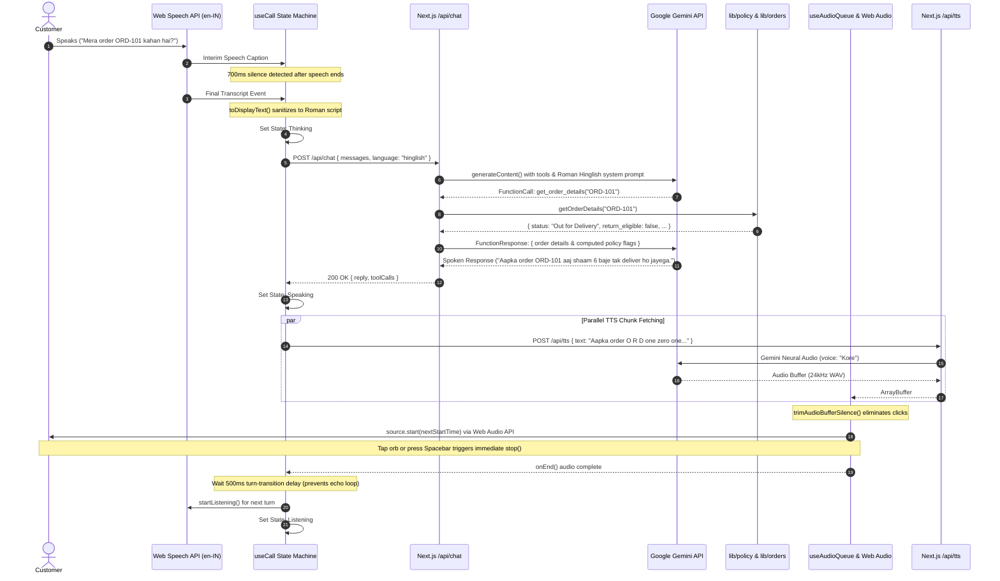

# System Architecture: Aria Voice Support Agent

## 1. Architectural Overview

Aria is a real-time, low-latency browser voice customer support specialist for Aura Skincare (Indian D2C skincare brand).
The architecture decouples heavy streaming infrastructure by leveraging:
1. **Client-side Speech Recognition (Web Speech API)**: Native client speech transcription (`en-IN`) with interim text previews and silence detection.
2. **Stateless Server API (Next.js App Router)**: Multi-model cascaded execution with Google Gemini (`@google/genai`), server-side deterministic tool calls, and in-memory policy evaluation.
3. **Dual-Path Speech Synthesis**: Primary neural Gemini TTS via Web Audio API with seamless back-to-back buffer scheduling; zero-latency locked female browser speech synthesis as transparent fallback.

---

## 2. Sequence Diagram: Single Turn Execution

---

## 3. Module Responsibilities

| Module | Location | Responsibility |
|---|---|---|
| **Types** | `lib/types.ts` | Strict TypeScript interfaces for `CallState`, `Language`, `MockOrder`, `ComputedOrderDetails`, `PostCallSummary`, and diagnostics. |
| **Config** | `lib/config.ts` | Centralized constants with documented rationale: silence timeout (700ms), transition delay (500ms), chunk sizes (80-200), female voice names, model fallbacks. |
| **Language & Script** | `lib/language.ts` | Pure functions for `detectLanguageChoice(transcript)` (client keyword detection), `toDisplayText(text)` (Devanagari to Roman transliteration), and `assertNoDevanagari(text)`. |
| **Business Policy** | `lib/policy.ts` | Pure deterministic business rules: return window check (<= 7 days), cancellation eligibility (`Processing` only), COD limits (<= ₹2500), and free shipping threshold (₹499). |
| **Order Store** | `lib/orders.ts` | In-memory mock database of orders (`ORD-101`, `ORD-102`, `ORD-103`), spoken digit phonetic normalization (`normalizeOrderId`), and transactional cancellation. |
| **Ticket Store** | `lib/tickets.ts` | In-memory store for support tickets (`TKT-1001`+ sequence) with 24-hour SLA. |
| **TTS & Sanitizer** | `lib/tts.ts` | Pure speakable-text sanitizer (`sanitizeForSpeech`) and sentence-level chunker (`chunkTextForSpeech`). |
| **Speech Player** | `lib/speech.ts` | Web Audio context management, silence trimming, locked female browser voice fallback, and versioned audio caching. |
| **Audio Hook** | `hooks/useAudioQueue.ts` | Client hook for audio playback lifecycle, interrupt handling, and fallback voice reporting. |
| **STT Hook** | `hooks/useSpeechRecognition.ts` | Web Speech API wrapper with 700ms silence detection and single-point transliteration. |
| **Call Machine Hook** | `hooks/useCall.ts` | High-level orchestrator: call state machine, language greeting flow, timer, mute, and API turn handling. |
