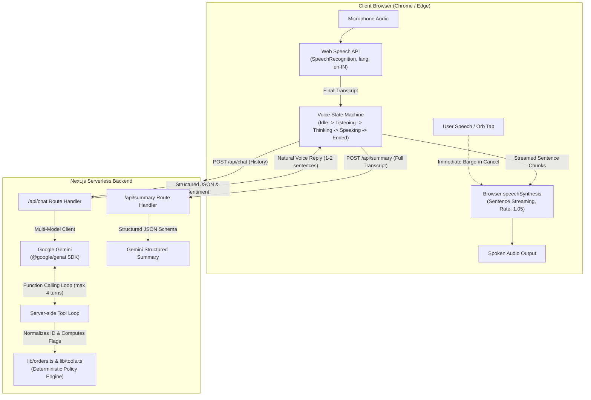

# Aria · Aura Skincare Voice Support Specialist

> **Live AI Voice Customer Support Agent for Aura Skincare (Indian D2C Skincare Brand)**  
> Built with Next.js (App Router), TypeScript, Tailwind CSS, Google Gemini (`@google/genai`), and Web Speech API.

---

## 1. Overview

**Aria** is a browser-based AI voice customer support specialist designed for **Aura Skincare**, a premium organic Indian D2C skincare brand. Customers can tap **"Start Call"**, speak naturally in Indian English or Roman Hinglish, and receive spoken replies from Aria in 1–2 concise, natural sentences.

When a customer inquires about their order, requests a return, or wants to cancel an item, Aria executes real-time server-side function calling, interprets **deterministic computed policy flags**, and adheres strictly to brand rules. When the call ends, Aria automatically generates a structured post-call JSON summary and sentiment analysis for auditing and CRM logging.

---

## 2. Key Features

- **Hands-Free Natural Voice Loop**: Continuous Speech Recognition (`en-IN`) with interim text previews and sentence-by-sentence text-to-speech streaming via `speechSynthesis`.
- **Instant Barge-In (Interruption)**: If the user speaks while Aria is speaking, or taps the central voice orb, speech synthesis immediately cancels and yields the floor to the user.
- **Robust Spoken Order ID Normalizer**: Normalizes spoken number words (e.g. *"o r d one zero one"*, *"ord 101"*, *"101"*) to canonical IDs (`ORD-101`).
- **Deterministic Computed Policy Engine**: The server-side tool computes `can_cancel`, `return_eligible`, and human-readable `return_note` so the LLM never has to perform hallucinated date calculations.
- **Safety Confirmation on Cancellations**: Aria strictly asks for explicit customer confirmation (*"Shall I go ahead and cancel order O R D 1 0 3 for you?"*) before invoking the `cancel_order` tool.
- **Automatic Multi-Model Spikes Fallback**: Automatically cascades across `gemini-3.6-flash`, `gemini-3.5-flash`, `gemini-3.1-flash-lite`, and `gemini-flash-lite-latest` if any temporary 429 quota or 503 capacity spikes occur on the primary model.
- **Automated Post-Call JSON Summary**: Guaranteed structured JSON adhering to strict schemas (`customer_intent`, `order_id`, `resolution_status`, `call_summary`, `tools_used`, `customer_sentiment`, `follow_up_needed`).
- **Minimalist Warm Aesthetic**: Palette featuring warm off-white (`#FAFAF7`), soft sage green (`#8FB8A0`), delicate blush (`#F6E7E0`), and an interactive multi-state Voice Orb.
- **Full Fallback Accessibility**: Text input bar for silent environments or unsupported browsers.

---

## 3. Architecture



---

## 4. Setup and Local Run

### Prerequisites
- Node.js `v18+` or `v20+` (tested on Node `v22`)
- npm or pnpm or yarn
- Google Gemini API Key

### Installation

```bash
# Clone or navigate to the directory
cd "Project voice agent"

# Install dependencies
npm install

# Configure environment variables
cp .env.example .env.local
```

### Environment Configuration (`.env.local`)

```env
GEMINI_API_KEY="your_gemini_api_key_here"
GEMINI_MODEL="gemini-3.6-flash"
```

### Run Locally

```bash
# Start Next.js development server
npm run dev
```

Open [http://localhost:3000](http://localhost:3000) in **Google Chrome** or **Microsoft Edge**.

---

## 5. Deployment to Vercel

The application is completely self-contained, adheres to the Next.js App Router standard, and runs effortlessly on Vercel:

```bash
# 1. Install Vercel CLI (if not already installed)
npm install -g vercel

# 2. Login to Vercel
vercel login

# 3. Deploy to preview
vercel

# 4. Set Production Environment Variables
vercel env add GEMINI_API_KEY production
vercel env add GEMINI_MODEL production

# 5. Deploy to Production
vercel --prod
```

> **Important Deployment Note for Audio & Mic**:  
> Web Speech Recognition requires a secure context (**HTTPS**). Vercel automatically provisions SSL certificates, so microphone permissions work out of the box on the deployed domain.

---

## 6. Test Script & Evaluation Conversations

You can run the automated scenario evaluation suite at any time:

```bash
node --dns-result-order=ipv4first test-scenarios.js
```

### Verified Test Scenarios

| Scenario | Customer Input | Expected Aria Behavior | Test Result |
| :--- | :--- | :--- | :--- |
| **1. Order Lookup** | *"Where is my order ORD-101?"* | Invokes `get_order_details('ORD-101')`. Reports Out for Delivery with BlueDart, expected by 6 PM today. Spells ID speakably (*"O R D one zero one"*). | ✅ PASSED |
| **2. Return Expired** | *"I received order ORD-102 two weeks ago. Can I return it?"* | Invokes `get_order_details('ORD-102')`. Detects `days_since_delivery: 14 > 7`. Politely declines return citing the 7-day policy. | ✅ PASSED |
| **3. Cancel Processing** | *"I want to cancel my order ORD-103"* | Checks status (Processing). **Asks confirmation first**: *"Shall I go ahead and cancel it?"* Once customer says *"Yes, please cancel"*, invokes `cancel_order` and confirms cancellation. | ✅ PASSED |
| **4. Cancel Dispatched** | *"Please cancel order ORD-101 immediately"* | Checks status (`Out for Delivery`). Declines online cancellation per policy; advises customer they may refuse delivery at the doorstep. | ✅ PASSED |
| **5. Invalid Order** | *"Can you check status for order ORD-999?"* | Invokes `get_order_details('ORD-999')`. Returns `ORDER_NOT_FOUND`. Politely asks customer to verify and repeat ID without hallucinating. | ✅ PASSED |
| **6. Out of Scope** | *"Can you book me a flight ticket to Goa?"* | Declines politely: explains she only handles Aura Skincare queries and offers assistance with skincare orders. | ✅ PASSED |
| **7. Unclear Audio** | *"uh... hmm..."* | Politely asks customer to repeat: *"I am sorry, I could not hear you clearly. Could you please repeat that?"* | ✅ PASSED |
| **8. Barge-in** | Customer speaks or taps orb while Aria is speaking | Calls `speechSynthesis.cancel()`, stops audio output immediately, and switches to user's turn. | ✅ PASSED |
| **9. Structured Summary** | End of call | Enforces JSON output with `customer_intent`, `order_id`, `resolution_status`, `tools_used`, `customer_sentiment`, `follow_up_needed`. | ✅ PASSED |

---

## 7. Known Limitations

1. **Browser Engine Support**: Browser `SpeechRecognition` relies on the Web Speech API, natively implemented in Chromium-based browsers (**Google Chrome**, **Microsoft Edge**, **Brave**). On unsupported browsers (such as Firefox desktop), a clear banner is presented and the accessible fallback text input is available.
2. **Headphones Recommended**: Without headphones, browser `speechSynthesis` playing through laptop speakers can be picked up by the microphone, inadvertently triggering a false barge-in. The UI includes an explicit user advisory.
3. **Browser TTS Voice Quality**: Browser `SpeechSynthesis` uses the client device's installed voice engines (e.g., Google Indian English or Microsoft Heera). While highly responsive and zero-cost, voice quality varies across operating systems compared to dedicated neural audio streaming APIs.

---

## 8. How I Think

### a) Why did you choose this architecture and stack?
I chose **Next.js App Router with TypeScript and Tailwind CSS** paired with the **browser Web Speech API** and **server-side Google Gemini (`@google/genai`) function calling** because it achieves the lowest possible round-trip latency without introducing heavy audio-streaming infrastructure or third-party telephony middleware. By running speech-to-text and text-to-speech directly in the client browser, we eliminate the 300–800ms transit delay of streaming raw PCM audio chunks over WebSockets to an external speech server. The Next.js API route acts as a secure, stateless gateway that holds the Gemini API key, executes the multi-turn tool calling loop, and computes business policy flags before returning clean, speakable text. This architecture offers instant deployment on Vercel with zero infrastructure overhead while maintaining deterministic business logic.

### b) What was the most difficult part and how did you solve it?
The most challenging aspect was **managing smooth turn-taking and spoken order-ID normalization without causing race conditions or hallucinated policy calculations**. When users speak alphanumeric IDs like *"o r d one zero one"* into the Web Speech API, transcription engines frequently output irregular casing, spaced letters, or spoken number words. I solved this by implementing a phonetic digit-normalizer in `lib/orders.ts` that maps number words to digits, strips extraneous punctuation, and reconstructs the canonical `ORD-XXX` format. Furthermore, LLMs frequently make subtle mathematical errors when calculating elapsed days between delivery and today; I resolved this by computing all policy eligibility flags (`can_cancel`, `return_eligible`, `days_since_delivery`, `return_note`) server-side in `lib/orders.ts`. Finally, I ensured barge-in responsiveness by having speech synthesis cancel immediately upon receiving an interim recognition result or an orb tap.

### c) If you had one more week, what would you improve first and why?
With an additional week, I would upgrade from the browser Web Speech API to **direct bidirectional audio streaming via WebSockets using Gemini Live (multimodal audio-to-audio) or Deepgram Nova-2 + ElevenLabs/Cartesia with Indian English voice models**. While browser Web Speech is lightweight and zero-cost, browser speech synthesis varies across operating systems and lacks the emotional warmth, breath, and natural prosody of dedicated Indian English voice models. Implementing client-side audio capture with an AudioWorklet and VAD (Voice Activity Detection) would virtually eliminate false barge-ins caused by acoustic echo. Additionally, I would introduce an automated CI/CD evaluation harness using promptfoo or synthetic customer audio benchmarks to regression-test policy edge cases and measuring turn-taking latency.

### d) At 1,000 calls/day, what would need to change?
At a scale of 1,000 calls per day, the system would require **production OMS/CRM integration, concurrency management, and robust security safeguards**. First, the in-memory mock database must be replaced with real-time transactional APIs (e.g. Shopify, Shiprocket, or an internal ERP) accompanied by a Redis cache for sub-20ms order lookups. Second, to protect customer privacy and prevent unauthorized cancellations, we would introduce cryptographic identity verification (such as sending a 4-digit OTP via SMS or WhatsApp before allowing cancellation or address disclosure). Third, concurrency and rate-limiting must transition to tier-based Redis token buckets with fallback LLM providers (e.g., Anthropic Claude or OpenAI) to maintain high availability during upstream outages. Finally, we would incorporate centralized telemetry (OpenTelemetry + Datadog/Langfuse) to monitor latency percentiles (P95/P99), capture customer sentiment trends, redact PII from transcripts, and trigger human agent escalation when sentiment drops below acceptable thresholds.

---

## 9. License

MIT © Aura Skincare. Built for hiring evaluation assignment.
